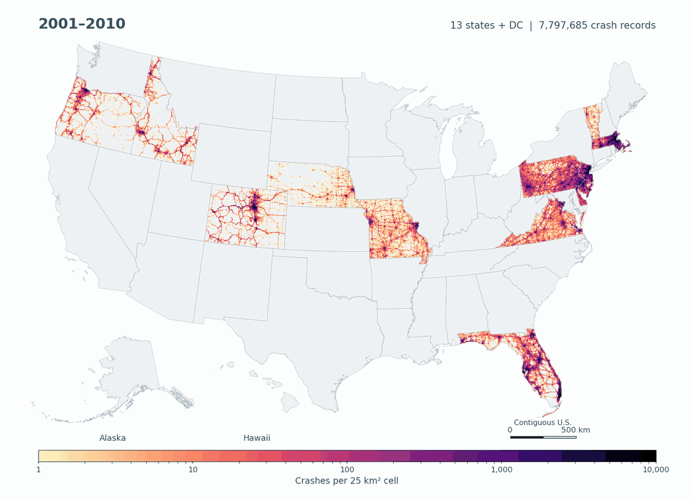

<div align="center">

# USCrash

### A Harmonized U.S. Nationwide Traffic Crash Dataset

Official state records. A common crash-level schema. Reproducible preparation.

**[Explore the website](https://ucfleihan.github.io/USCrash/)** · **[Manuscript](papers/uscrash-paper.pdf)** · **[Supplementary material](papers/uscrash-supplementary.pdf)** · **[Data access](DATA_ACCESS.md)**

Lei Han · University of Central Florida

</div>

<br>

| Crash records | Geographic coverage | Overall time span | Common schema |
| :---: | :---: | :---: | :---: |
| **65,756,924** | **41 states + DC** | **2001–2026** | **77 fields** |

<a href="https://ucfleihan.github.io/USCrash/">
  
</a>

<sub>Coverage varies by state and year; 2026 is partial. The animation shows records with usable locations and uses grouped periods at the beginning and end. Its displayed counts follow the map population rather than the complete dataset.</sub>

## About USCrash

USCrash brings heterogeneous official state crash records into a common representation for cross-state and longitudinal traffic safety research. The current dataset contains **511 annual CSV files**, with documented source coverage and provenance.

- **Broad coverage and scale.** Over 65.7 million records spanning 2001–2026, with source-specific reporting scope retained.
- **Semantic harmonization.** An MMUCC-guided schema organizes 77 fields across eight groups, alongside source codes and mapping information.
- **Reproducible preparation.** Acquisition and processing tools, executable mappings, file catalogs, and checksums document how the data were prepared.

## Start here

| I want to… | Open |
| :--- | :--- |
| Explore coverage, distributions, and comparisons | [Interactive project website](https://ucfleihan.github.io/USCrash/) |
| Understand the dataset and its limitations | [Dataset card](dataset/DATASET_CARD.md) |
| Inspect the 77 fields | [Field dictionary](dataset/docs/data_dictionary.csv) |
| Check included sources and years | [Source inventory](dataset/docs/data_sources.csv) · [State coverage](dataset/docs/state_coverage.csv) |
| Follow the processing workflow | [Code guide](code/README.md) · [Field mapping](docs/FIELD_MAPPING.md) |
| Find the data release | [Data access and release status](DATA_ACCESS.md) |

## Data availability

**The full record-level data are not included in this GitHub repository.** Public download links and a DOI will be added after the source-specific release review is complete.

The planned distribution uses separate state/DC archives, plus metadata and code packages. This allows users to download only the jurisdictions they need. See [data access](DATA_ACCESS.md) for the file layout and verification instructions.

This repository contains the project website, figures, lightweight aggregate data, manuscript previews, code, schema definitions, mappings, and file manifests. CSV files in the repository describe fields, mappings, or coverage; they are not the full crash records.

<details>
<summary><strong>Repository layout</strong></summary>

```text
USCrash/
├── index.html                  Project website entry
├── assets/                     Website styles, scripts, figures, and aggregates
├── code/                       Acquisition, processing, mappings, and replay
├── dataset/                    Dictionary, source schemas, coverage, and catalogs
├── docs/                       Repository guides and historical release notes
├── papers/                     Manuscript and supplement previews
├── DATA_ACCESS.md              Data access and release status
├── DATA_LICENSE.md             License scope and source-data terms
└── DISCLAIMER.md               Research use and interpretation
```

Some supporting documents retain the original research directory structure. See the [code guide](code/README.md) before running acquisition or replay scripts; some steps require local raw inputs and path configuration.

</details>

## Interpretation and responsible use

Coverage and reporting practices differ across sources. Blank or unknown values are not negative observations. Oklahoma includes a K/A/B subset; North Carolina 2016–2020 includes fatal and serious-injury crashes. Attribute availability measures valid analytical field–record cells, rather than complete crash records or accuracy.

The website reflects the corrected Florida 2017–2019 data. Manuscript PDFs and some original figures are previews and may contain earlier values. Consult the [dataset card](dataset/DATASET_CARD.md) for the current scope.

USCrash is an independently prepared research resource, not an official agency product. Data and supporting materials are provided “as is,” may contain errors or omissions, and do not imply agency endorsement. Users must not attempt to identify individuals. See the [disclaimer](DISCLAIMER.md).

## License and citation

**CC BY-NC 4.0 applies only to eligible original USCrash contributions.** It does not replace upstream licenses, restrict public-domain facts, or grant blanket redistribution permission for state records. Source-specific release conditions and the code license remain under review. Read [DATA_LICENSE.md](DATA_LICENSE.md) for the scope.

Publication details, the dataset DOI, and the final citation are pending. Until then, identify the version used and link to this repository; do not treat the manuscript preview as a published citation.

---

<div align="center">

[Website](https://ucfleihan.github.io/USCrash/) · [Paper](papers/uscrash-paper.pdf) · [Data access](DATA_ACCESS.md) · [Report an issue](https://github.com/UCFLeiHan/USCrash/issues)

</div>
